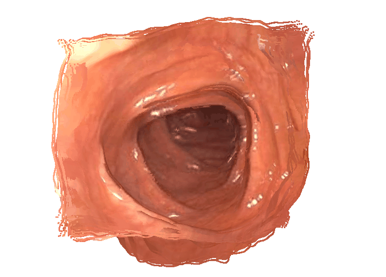
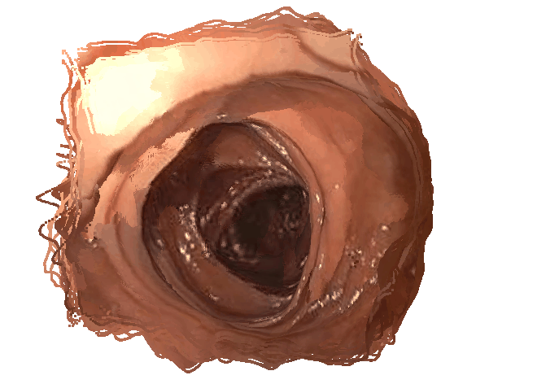
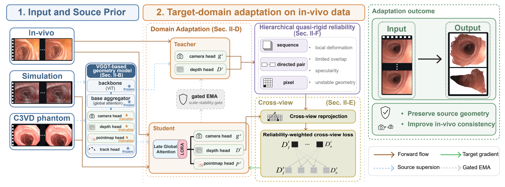

<h1 align="center">Colon3R: Cross-Domain 3D Reconstruction from Monocular Colonoscopic Video</h1>

<p align="center">
  <a href="https://arxiv.org/abs/2609.23961"><strong>Paper (arXiv)</strong></a>
</p>

<p align="center">
  Zhihao Xing &nbsp;&nbsp; Yingyu Wang &nbsp;&nbsp; Liang Zhao &nbsp;&nbsp; Shoudong Huang
</p>

## In-vivo Reconstruction

<p align="center">
  
  
</p>

<p align="center"><strong>Segment 1 (left) &nbsp;&nbsp; · &nbsp;&nbsp; Segment 2 (right)</strong></p>


## Overview

<p align="center">
  
</p>

Colon3R adapts VGGT from labeled phantom and simulated data to unlabeled in-vivo colonoscopy. It selects cross-view supervision at sequence, directed-pair and pixel levels, while retaining source supervision and constraining target updates to preserve coupled camera, depth and pointmap geometry.

## Repository

```text
Colon3R/
  train.py
  inference.py
  configs/colon3r.yaml
  checkpoints/
    colon3r.pt
  colon3r/
```

VGGT is the only external model source dependency. The geometry, supervision, reliability, and adaptation code used by Colon3R is included in the `colon3r` package.

## Environment

The verified environment used Python 3.11, PyTorch 2.2.2, torchvision 0.17.2, CUDA 11.8, NumPy 1.26.4, Pillow 10.3.0, PyYAML 6.0.1, and Kornia 0.7.2. Training and inference require at least one CUDA GPU with bf16 support. Additional GPUs can be selected at launch time.

```bash
conda create -n colon3r python=3.11 -y
conda activate colon3r
pip install -r requirements.txt

mkdir -p third_party
git clone https://github.com/facebookresearch/vggt.git third_party/VGGT
pip install -e third_party/VGGT
```

Set `VGGT_ROOT` or update `paths.vggt_root` when VGGT is not under `third_party/VGGT`.

VGGT base weights are loaded through `VGGT.from_pretrained("facebook/VGGT-1B")`; make that Hugging Face artifact available in the local cache for offline execution.

## Checkpoints

`colon3r.pt`

Place the checkpoint in `checkpoints/`. The download link will be added here when available.

## Data

All manifests are JSONL. Every row contains exactly eight chronological frames. Paths can be absolute or relative to the repository working directory.

C3VD source rows use official Scaramuzza calibration and camera-Z depth:

```json
{"clip_id":"c3vd-example","source":"c3vd","camera_model":"official_scaramuzza_omnidirectional","fallback_used":false,"clip_length":8,"frame_ids":[0,1,2,3,4,5,6,7],"rgb_paths":["..."],"depth_paths":["..."],"pose_path":".../poses_gt.txt"}
```

Each `poses_gt.txt` row is a row-major 4x4 camera-to-world matrix. The loader inverts it only where a world-to-camera transform is required. C3VD depth images are official 16-bit 0–100 mm camera-Z maps. Put the verified calibration and FOV mask at:

```text
data/source/calibration/cfhq190l_omnidirectional_calibration.json
data/source/calibration/c3vd_fov_mask.png
```

Sim source rows use explicit pinhole cameras:

```json
{"clip_id":"sim-example","source":"sim","camera_model":"explicit_pinhole","fallback_used":false,"clip_length":8,"frame_ids":[0,1,2,3,4,5,6,7],"rgb_paths":["..."],"depth_cache":".../depth.npz","intrinsics_path":".../intrinsics.json","pose_path":".../poses.txt"}
```

The sim depth NPZ contains `depth` and `valid` arrays. The intrinsics JSON contains `fx`, `fy`, `cx`, and `cy`.

Target rows are RGB-only. Any depth, pose, intrinsic, calibration, mesh, trajectory, or pointmap field is rejected:

```json
{"clip_id":"target-example","procedure_id":"procedure-01","source":"target","supervised":false,"clip_length":8,"frame_ids":[0,1,2,3,4,5,6,7],"rgb_paths":["..."]}
```

Update the portable paths in `configs/colon3r.yaml`, or override the source and target manifests on the command line.

## Training

The fixed protocol is:

- one or more user-selected CUDA workers, with NCCL gradient averaging for multi-GPU runs;
- three labeled source microbatches and one unlabeled target microbatch per update;
- eight Teacher views, eight Student views, and 56 directed pairs;
- rank-16, alpha-16, zero-dropout Q/V/O LoRA in global blocks 12–23;
- source updates to LoRA plus camera/depth/point heads;
- target updates to LoRA plus depth head only;
- AdamW with peak rates `2e-5`, `2e-7`, `1e-7`, and `5e-8` for LoRA, depth, point, and camera;
- bf16 model forwards and fp32 geometry/loss reduction;
- fixed Teacher through update 499, hard copy at 500, then gated EMA with momentum 0.996;
- support threshold `0.20138970316367508`, scale threshold `0.004409444387420081`, and depth-anchor weight `0.05`;
- 6000 adaptation updates from global step 4000 to 10000.

GPU count is selected by the launch command, not by the scientific YAML configuration. For one GPU:

```bash
CUDA_VISIBLE_DEVICES=0 python train.py \
  --config configs/colon3r.yaml \
  --output outputs/colon3r_run \
  --c3vd-fov-mask data/source/calibration/c3vd_fov_mask.png
```

For multiple GPUs, expose the desired devices and use the same number of local workers. For example, with two GPUs:

```bash
CUDA_VISIBLE_DEVICES=0,1 torchrun --standalone --nproc_per_node=2 train.py \
  --config configs/colon3r.yaml \
  --output outputs/colon3r_run \
  --c3vd-fov-mask data/source/calibration/c3vd_fov_mask.png
```

The released 10k checkpoint was produced with two workers. Changing the worker count changes the effective global batch and therefore will not reproduce the exact optimization trajectory. Resume with the same worker count used to create the checkpoint:

```bash
CUDA_VISIBLE_DEVICES=0,1 torchrun --standalone --nproc_per_node=2 train.py \
  --config configs/colon3r.yaml \
  --output outputs/colon3r_run \
  --resume checkpoints/colon3r.pt \
  --c3vd-fov-mask data/source/calibration/c3vd_fov_mask.png
```

The trainer writes rank-local JSONL metrics and rank-zero checkpoints at global step 4020, then every 1000 global steps, and at the requested terminal step. Existing checkpoints are never overwritten. Every saved checkpoint is immediately hash-verified and reloaded.

## Inference

Pass one directory containing exactly eight RGB images, one text file containing eight image paths, or eight explicit image paths:

```bash
python inference.py \
  --input examples/frames \
  --checkpoint checkpoints/colon3r.pt \
  --output outputs/example \
  --export-ply
```

Inference performs one frozen eight-frame aggregator pass and saves:

```text
outputs/example/
  predictions.npz
  metadata.json
  direct_pointmap_fused_rgb.ply
  per_frame/direct_pointmap_00_rgb.ply
  ...
```

`predictions.npz` contains `extrinsics_w2c`, `intrinsics`, `depth_z`, `depth_confidence`, `direct_pointmap`, and `pointmap_confidence`. Extrinsics follow OpenCV world-to-camera convention. Depth is camera-axis Z. Direct pointmaps remain in native VGGT first-frame-normalized world coordinates.

PLY export is finite-point filtering and concatenation only. It does not apply confidence quantile filtering, Sim(3), ICP, GT alignment, TSDF, surface fusion, or meshing.

## Scope

C3VD supervision uses the official Scaramuzza omnidirectional ray model with `X_camera = unit_ray * depth_z / unit_ray_z`. Sim supervision uses explicit pinhole intrinsics. Unlabeled in-vivo target geometry uses Teacher-predicted pinhole intrinsics because no calibrated target camera is supplied.

The final model reflects its stated source supervision and target adaptation data. Comparisons with other systems should not be described as architecture-only comparisons when their training data or supervision differ.

## Acknowledgements

We thank the authors of [VGGT](https://github.com/facebookresearch/vggt) for their open-source implementation.
